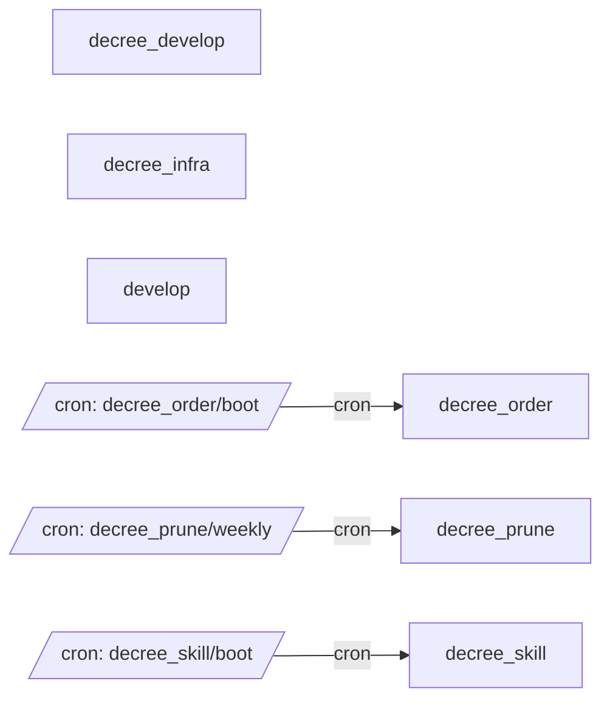

# All machines

Every machine, the `emits` and `invokes` edges between them, and cron entry points.

- [decree_develop](machines/decree_develop/graph.md): Implement a message with the AI in small, logged steps, run the project's gate, have the AI fix failures only if the gate fails, then have the AI check the acceptance criteria.
- [decree_infra](machines/decree_infra/graph.md): Add to the environment the project needs, the first time and every time after; the AI declares each resource in the machine's scripts/requirements (a project's plugin that extends decree_infra), then apply installs what is missing and checks every line.
- [decree_order](machines/decree_order/graph.md): At daemon start, run each machine's order/ files one at a time in file-name order, once each, and again when a file changes.
- [decree_prune](machines/decree_prune/graph.md): Each week, delete the folders of finished runs older than PRUNE_OLDER_THAN (default 30d).
- [decree_skill](machines/decree_skill/graph.md): Keep the decree skill in the project, .claude/skills/decree/ or .github/skills/decree/ (or each folder scripts/dirs lists), the one this decree ships, each time the daemon starts.
- [develop](machines/develop/graph.md): Implement a message with the AI in small, logged steps, run the project's gate, have the AI fix failures only if the gate fails, then have the AI check the acceptance criteria.

